# Modelo de dados e ERD

- Status: Approved logical baseline; migrations remain gated
- Banco baseline: PostgreSQL 16+
- Identificadores: UUID/UUIDv7 ou equivalente não sequencial, decisão final no scaffold
- Escopo: modelo lógico; nomes/tipos finais dependem de migration revisada

`OFFER` é a representação do plano/termos comerciais do seller no MVP. `SAAS_PLAN`
e `SELLER_SAAS_SUBSCRIPTION` são uma projeção local do billing SaaS corporativo;
não são preço ou checkout do seller e não recebem `operator_id` do browser.

## ERD

```mermaid
erDiagram
    IDENTITY_USER {
      uuid id PK
      string identity_sub UK
      string email_normalized
      boolean email_verified
      timestamptz created_at
    }
    PLATFORM_GRANT {
      uuid id PK
      uuid identity_user_id FK
      string role
      string status
      timestamptz granted_at
    }
    BUYER_PROFILE {
      uuid identity_user_id PK,FK
      string display_name
      jsonb preferences
      timestamptz updated_at
    }
    SUPERADMIN_BOOTSTRAP {
      uuid id PK
      string singleton_key UK
      uuid identity_user_id FK
      string identity_sub UK
      timestamptz consumed_at
    }
    SELLER_ORGANIZATION {
      uuid id PK
      string slug UK
      string status
      timestamptz created_at
    }
    SELLER_MEMBERSHIP {
      uuid seller_organization_id PK,FK
      uuid identity_user_id PK,FK
      string role
      string status
    }
    STOREFRONT {
      uuid seller_organization_id PK,FK
      string display_name
      jsonb public_branding
      string status
    }
    CATALOG_PRODUCT {
      uuid seller_organization_id PK,FK
      uuid id PK
      string slug
      string status
      uuid published_snapshot_id
    }
    OFFER {
      uuid seller_organization_id PK,FK
      uuid id PK
      uuid catalog_product_id FK
      string status
      jsonb terms
    }
    COURSE {
      uuid seller_organization_id PK,FK
      uuid id PK
      string status
      bigint draft_version
    }
    PRODUCT_COURSE {
      uuid seller_organization_id PK,FK
      uuid catalog_product_id PK,FK
      uuid course_id PK,FK
    }
    COURSE_MODULE {
      uuid seller_organization_id PK,FK
      uuid id PK
      uuid course_id FK
      integer position
    }
    LESSON {
      uuid seller_organization_id PK,FK
      uuid id PK
      uuid course_id FK
      uuid module_id FK
      integer position
    }
    CONTENT_BLOCK {
      uuid seller_organization_id PK,FK
      uuid id PK
      uuid course_id FK
      uuid lesson_id FK
      string kind
      jsonb content
      integer position
    }
    ASSET {
      uuid seller_organization_id PK,FK
      uuid id PK
      string object_key UK
      string status
      string sha256
    }
    CONTENT_ASSET {
      uuid seller_organization_id PK,FK
      uuid content_block_id PK,FK
      uuid asset_id PK,FK
    }
    PUBLICATION {
      uuid seller_organization_id PK,FK
      uuid id PK
      uuid catalog_product_id FK
      integer version
      jsonb snapshot
      timestamptz published_at
    }
    ENTITLEMENT {
      uuid seller_organization_id PK,FK
      uuid id PK
      uuid buyer_identity_user_id FK
      uuid catalog_product_id FK
      uuid external_purchase_id FK
      string status
      timestamptz valid_from
      timestamptz valid_to
    }
    ENROLLMENT {
      uuid seller_organization_id PK,FK
      uuid id PK
      uuid buyer_identity_user_id FK
      uuid entitlement_id FK
      uuid catalog_product_id FK
      uuid course_id FK
      string status
    }
    LESSON_PROGRESS {
      uuid seller_organization_id PK,FK
      uuid enrollment_id PK,FK
      uuid buyer_identity_user_id PK,FK
      uuid course_id PK,FK
      uuid lesson_id PK,FK
      integer progress_percent
      timestamptz updated_at
    }
    SAAS_PLAN {
      uuid id PK
      string key UK
      string status
      jsonb limits
    }
    SELLER_SAAS_SUBSCRIPTION {
      uuid seller_organization_id PK,FK
      uuid saas_plan_id FK
      string status
      timestamptz current_period_end
    }
    INTEGRATION {
      uuid seller_organization_id PK,FK
      uuid id PK
      string provider
      string status
    }
    WEBHOOK_ENDPOINT {
      uuid seller_organization_id PK,FK
      uuid id PK
      uuid integration_id FK
      string secret_reference
    }
    EXTERNAL_PRODUCT_MAPPING {
      uuid seller_organization_id PK,FK
      uuid integration_id PK,FK
      string external_product_id PK
      uuid catalog_product_id FK
    }
    WEBHOOK_EVENT {
      uuid seller_organization_id PK,FK
      uuid id PK
      uuid webhook_endpoint_id FK
      string external_event_id
      string processing_status
      jsonb payload_encrypted
    }
    EXTERNAL_PURCHASE {
      uuid seller_organization_id PK,FK
      uuid id PK
      uuid integration_id FK
      string external_purchase_id
      uuid buyer_identity_user_id FK
      uuid catalog_product_id FK
      string status
    }
    OUTBOX_EVENT {
      uuid id PK
      uuid seller_organization_id FK
      string aggregate_type
      uuid aggregate_id
      integer schema_version
      string status
    }
    AUDIT_EVENT {
      uuid id PK
      uuid seller_organization_id FK
      uuid actor_identity_user_id FK
      string action
      string target_type
      uuid target_id
      string result
    }

    IDENTITY_USER ||--o{ PLATFORM_GRANT : has
    IDENTITY_USER ||--o| BUYER_PROFILE : has
    IDENTITY_USER ||--o| SUPERADMIN_BOOTSTRAP : consumes
    IDENTITY_USER ||--o{ SELLER_MEMBERSHIP : joins
    SELLER_ORGANIZATION ||--o{ SELLER_MEMBERSHIP : contains
    SELLER_ORGANIZATION ||--|| STOREFRONT : owns
    SELLER_ORGANIZATION ||--o{ CATALOG_PRODUCT : owns
    CATALOG_PRODUCT ||--o{ OFFER : has
    SELLER_ORGANIZATION ||--o{ COURSE : owns
    SELLER_ORGANIZATION ||--o| SELLER_SAAS_SUBSCRIPTION : pays
    SAAS_PLAN ||--o{ SELLER_SAAS_SUBSCRIPTION : selected_by
    CATALOG_PRODUCT ||--o{ PRODUCT_COURSE : grants
    COURSE ||--o{ PRODUCT_COURSE : included_in
    COURSE ||--o{ COURSE_MODULE : contains
    COURSE_MODULE ||--o{ LESSON : contains
    LESSON ||--o{ CONTENT_BLOCK : contains
    CONTENT_BLOCK ||--o{ CONTENT_ASSET : uses
    ASSET ||--o{ CONTENT_ASSET : attached
    CATALOG_PRODUCT ||--o{ PUBLICATION : snapshots
    IDENTITY_USER ||--o{ ENTITLEMENT : buyer_has
    CATALOG_PRODUCT ||--o{ ENTITLEMENT : grants
    ENTITLEMENT ||--o{ ENROLLMENT : creates
    COURSE ||--o{ ENROLLMENT : enrolls
    ENROLLMENT ||--o{ LESSON_PROGRESS : tracks
    LESSON ||--o{ LESSON_PROGRESS : measured_by
    SELLER_ORGANIZATION ||--o{ INTEGRATION : owns
    INTEGRATION ||--o{ WEBHOOK_ENDPOINT : exposes
    INTEGRATION ||--o{ EXTERNAL_PRODUCT_MAPPING : maps
    CATALOG_PRODUCT ||--o{ EXTERNAL_PRODUCT_MAPPING : target
    WEBHOOK_ENDPOINT ||--o{ WEBHOOK_EVENT : receives
    INTEGRATION ||--o{ EXTERNAL_PURCHASE : reports
    EXTERNAL_PURCHASE ||--o{ ENTITLEMENT : originates
    SELLER_ORGANIZATION ||--o{ OUTBOX_EVENT : scopes
    IDENTITY_USER ||--o{ AUDIT_EVENT : acts
```

`PK,FK` no diagrama indica participação lógica em chave composta. A sintaxe SQL
final deve nomear constraints e índices explicitamente.

## Invariantes estruturais

### Identidade e grants

1. `identity_sub` é único, imutável e nunca reciclado pelo AppSell.
2. E-mail é atributo de contato/cache; não participa de FK, membership ou grant.
3. Um bootstrap consumido é único; não pode ser apagado pela role de runtime.
4. Roles usam enum/check constraint e estado explícito, não string livre.
5. Revogação encerra sessões afetadas por evento/outbox idempotente.

### Tenant

1. Toda tabela privada do seller contém `seller_organization_id NOT NULL`.
2. Toda entidade referenciável expõe unique `(seller_organization_id, id)`.
3. Toda FK seller-scoped inclui o mesmo `seller_organization_id` nos dois lados.
4. Unique de slug/mapping/evento inclui seller/endpoint apropriado.
5. `seller_organization_id` é imutável; mover recurso entre sellers é export/import
   explícito, não `UPDATE`.
6. Soft delete/status preserva tenant e histórico.

### Catálogo e conteúdo

1. `ProductCourse` só conecta produto e curso do mesmo seller.
2. Module, lesson, block e asset seguem a cadeia do mesmo seller.
3. `position >= 0` e unique por pai evitam ordenação ambígua.
4. Publication é append-only e unique `(seller, product, version)`.
5. Ponteiro publicado referencia publication do mesmo seller/produto.
6. Snapshot não contém secret, URL assinada ou PII de buyer.

### Buyer, entitlement e progresso

1. Buyer é `identity_user`; não existe ID de buyer fornecido pelo browser para
   rotas `/me`.
2. Entitlement contém buyer + seller + produto do mesmo seller.
3. Origem comercial, quando presente, é purchase do mesmo seller/buyer/produto;
   FK composta inclui os três vínculos.
4. Enrollment contém buyer, entitlement e produto; FK composta inclui
   `(seller, entitlement_id, buyer_identity_user_id, catalog_product_id)` para
   impedir que buyer Y use entitlement de buyer X no mesmo produto.
5. Enrollment contém curso alcançável pelo produto no mesmo seller.
6. Progress contém buyer, enrollment, curso e lesson; FKs compostas provam que a
   aula pertence ao curso matriculado e ao buyer correto.
7. Update de progresso é monotônico ou segue regra de reset explícita e auditada.
8. Revogação não apaga histórico; muda capacidade de leitura conforme política.

### Constraints de bootstrap, owner e caminho de aprendizagem

- `SUPERADMIN_BOOTSTRAP.singleton_key` é sempre `default` e possui unique global;
  junto com lock transacional, isso permite no máximo um bootstrap consumido.
- `SELLER_MEMBERSHIP` possui índice unique parcial para um único `seller_owner`
  ativo por seller; transferência exige aceite, auditoria e transação.
- `COURSE_MODULE` e `LESSON` repetem `course_id`; FKs compostas impedem aula de
  outro curso mesmo quando o UUID existe.
- As chaves únicas auxiliares são `(seller, id, course_id)` em módulos e aulas;
  `LESSON` referencia `(seller, course_id, module_id)` e `CONTENT_BLOCK`
  referencia `(seller, course_id, lesson_id)`.
- `ENTITLEMENT` e `EXTERNAL_PURCHASE` expõem uniques auxiliares com seller, id,
  buyer e produto para que a origem comercial não possa cruzar identidades.
- `ENROLLMENT` referencia `(seller, entitlement_id, buyer, catalog_product_id)` e
  `(seller, catalog_product_id, course_id)`; `LESSON_PROGRESS` referencia
  `(seller, enrollment_id, buyer, course_id)` e `(seller, course_id, lesson_id)`.

### Webhooks e jobs

1. Endpoint pertence a uma integration e seller; payload não escolhe tenant.
2. Unique `(webhook_endpoint_id, external_event_id)` impede duplicata; fallback
   por fingerprint exige regra específica do provider.
3. Raw/fato recebido é imutável; status de processamento fica em colunas/tabelas
   separadas.
4. Purchase é unique por `(integration_id, external_purchase_id)` no seller.
5. Outbox é criada na mesma transação do efeito de domínio.
6. Job/outbox possui schema version e idempotency key quando produz efeito.
7. Redis pode ser reconstruído a partir do PostgreSQL.

## Índices mínimos propostos

- memberships por `(identity_user_id, status)` e `(seller, role, status)`;
- produtos públicos por `(seller, status, slug)` com índice parcial para
  published;
- entitlements `/me` por `(buyer_identity_user_id, status)` incluindo seller e
  produto;
- entitlements administrativos por `(seller, catalog_product_id, status)`;
- progress por `(seller, enrollment_id, updated_at)`;
- buyer profiles por `(identity_user_id)` e assinatura SaaS por `(seller, status)`;
- webhook unique por endpoint/event ID e fila por processing status/received_at;
- outbox por `(status, available_at, created_at)`;
- audit por seller/time, actor/time e target.

Índice não substitui teste com plano real e cardinalidade representativa.

## RLS proposta

| Classe | Policy |
|---|---|
| seller admin | seller do contexto deve coincidir com a linha e membership/capability já validada |
| buyer `/me` | `buyer_identity_user_id` deve coincidir com a identidade do contexto |
| catálogo público | usar view/projeção dedicada de published, sem conceder SELECT nas tabelas privadas |
| worker | contexto seller obrigatório por item; sem policy global permissiva |
| plataforma | repository/capability específico e auditado; sem bypass permanente |

Policies usam configuração transacional ou mecanismo equivalente que o usuário
SQL da aplicação não consiga falsificar. A role de runtime não é dona das tabelas
e não possui `BYPASSRLS`.

## Dados fora do PostgreSQL

- storage guarda bytes; Postgres guarda owner/seller, hash, estado e chave opaca;
- secret manager guarda secrets; banco guarda somente referência/versão;
- Redis guarda cache/lease/rate limit reconstruível;
- vault guarda tokens de sessão criptografados e vinculados à sessão opaca;
- logs/telemetria guardam IDs opacos e campos allowlisted.

## Testes de invariantes

Cada migration que cria/altera relação seller-scoped inclui testes SQL diretos:

- insert/update cross-tenant falha por FK/check;
- select/update/delete sem contexto falha por RLS;
- pool reutilizado não herda tenant;
- buyer X não seleciona buyer Y;
- duplicata concorrente viola unique de forma tratada/idempotente;
- publication/event/audit imutáveis não são alteráveis pela role de runtime;
- migration funciona em banco vazio e snapshot N-1.
