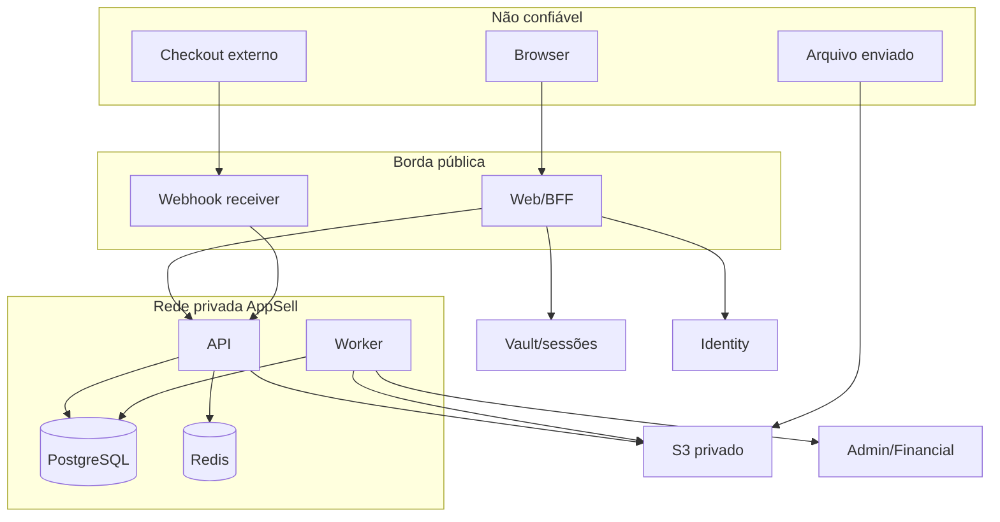

# Threat model — Autonom.ia Sell

- Status: Proposed
- Método: STRIDE + abuso de negócio
- Data-base: 2026-07-10
- Escopo: MVP descrito nos ADRs; nenhum ambiente de produção

## 1. Objetivos de segurança

1. Impedir leitura, escrita ou enumeração entre sellers.
2. Impedir que um buyer acesse conteúdo sem entitlement próprio e ativo.
3. Manter tokens do Identity fora do browser e dos logs.
4. Impedir elevação por e-mail, claim não validada ou header do client.
5. Processar vendas externas sem duplicar ou forjar entitlement.
6. Manter draft, asset e PII privados fora de catálogo/cache público.
7. Preservar trilha auditável sem criar um novo vazamento de dados.
8. Permitir rollback/restore sem corromper schema, jobs ou eventos.

## 2. Ativos

| Ativo | Sensibilidade | Impacto principal |
|---|---|---|
| Sessão BFF e tokens no vault | Crítica | takeover e acesso a serviços corporativos |
| Grants globais/memberships | Crítica | elevação e acesso cross-tenant |
| Entitlements/compras | Alta | acesso indevido e impacto financeiro |
| Conteúdo/arquivos privados | Alta | vazamento de propriedade intelectual |
| PII de buyer/seller | Alta | LGPD, fraude e reputação |
| Secrets de webhook/serviço | Crítica | eventos e chamadas forjadas |
| Draft/snapshots publicados | Alta | perda de conteúdo e publicação indevida |
| Audit log | Alta | não repúdio, mas também PII operacional |
| Outbox/jobs/dead-letter | Alta | perda, duplicidade ou efeito entre tenants |
| Backups/SBOM/imagens | Alta | recuperação e supply chain |

## 3. Atores

- visitante anônimo;
- buyer legítimo ou malicioso;
- seller owner/admin/editor/support;
- platform support/auditor/superadmin;
- checkout externo e serviços corporativos;
- atacante de internet;
- dependência/artefato comprometido;
- operador interno negligente ou malicioso;
- worker/BFF/API comprometido.

## 4. Fronteiras de confiança

Toda seta cruza uma fronteira e exige autenticação, autorização, validação de
schema, timeout e logging redigido compatíveis com o risco. “Rede privada” reduz
exposição; não transforma chamadas em confiáveis.

## 5. Ameaças priorizadas

| ID | Ameaça/abuso | Categoria | Risco inerente | Controles exigidos | Evidência/gate |
|---|---|---|---|---|---|
| TM-01 | Seller A troca ID/slug e lê/escreve B | S/I/E | Crítico | tenant em toda chave, FK composta, RLS, deny default | suíte cross-tenant API + SQL |
| TM-02 | Buyer usa entitlement A para conteúdo B | T/I/E | Crítico | entitlement buyer+seller+product; enrollment/asset coerentes | buyer A+B e negative cases |
| TM-03 | E-mail forjado/não verificado concede superadmin | S/E | Crítico | token validado, `email_verified`, MFA, one-shot, grant por `sub` | bootstrap adversarial |
| TM-04 | Qualquer JWT/header é aceito como identidade | S/E | Crítico | validação `iss/aud/exp/token_use`, BFF autenticado, envelope curto | tokens/header forjados negados |
| TM-05 | JWT/refresh token roubado por XSS/storage | S/I/E | Crítico | sessão opaca HttpOnly, CSP, tokens server-side | inspeção browser/DOM/logs |
| TM-06 | CSRF de subdomínio irmão executa mutação | S/T | Alto | Origin exata + CSRF vinculado à sessão | testes missing/foreign origin |
| TM-07 | Fixation/replay de state, code ou sessão | S/R | Alto | aleatoriedade, single-use, rotação, TTL | replay concorrente negado |
| TM-08 | Superadmin/support acessa conteúdo sem necessidade | I/E | Crítico | sem bypass, support workflow temporal e auditado | matriz + testes de negação |
| TM-09 | Webhook forjado concede acesso | S/T/E | Crítico | HMAC raw body, endpoint→seller server-side, janela temporal | assinatura/segredo cruzado |
| TM-10 | Duplicata/crash cria dois entitlements | T/R | Alto | unique, transação, outbox e efeito idempotente | concorrência + kill worker |
| TM-11 | Evento fora de ordem reativa compra revogada | T | Alto | versão/precedência e ledger imutável | permutações de eventos |
| TM-12 | `operator_id`/preço do browser afeta Financial | T/E | Crítico | Financial corporativo separado, valores server-side | contract/negative test |
| TM-13 | Draft aparece no catálogo/player | I | Alto | snapshot e projeção pública explícita | publish/draft E2E |
| TM-14 | Upload ativo/polyglot executa no domínio | T/E | Crítico | magic bytes, allowlist, scan, reprocessamento, CSP | corpus malicioso |
| TM-15 | URL assinada/cache vaza asset privado | I | Alto | auth antes da emissão, TTL curto, cache privado, sem SW | logout/expiry/cache tests |
| TM-16 | Autosave concorrente perde conteúdo | T/R | Alto | optimistic lock, idempotency e UX de conflito | dois editores/rede ruim |
| TM-17 | RLS ausente/desabilitada em migration | I/E | Crítico | CI de policies, runtime sem BYPASSRLS/owner | teste conexão direta |
| TM-18 | Pool reutiliza tenant anterior | I/E | Crítico | contexto por transação e limpeza/fail closed | reuse/concurrency test |
| TM-19 | Job sem tenant processa lote cruzado | T/I/E | Crítico | tenant obrigatório por job e repository | payload adulterado negado |
| TM-20 | Logs/telemetria contêm token, URL ou PII | I | Alto | redaction, allowlist de campos, teste de log | scan de fixtures/logs |
| TM-21 | Dependência/imagem comprometida | T/E | Alto | lock, provenance, SBOM, scan e digest | CI supply-chain |
| TM-22 | Backup não restaura ou restaura seller errado | T/I/A | Alto | criptografia, restore isolado, validação de tenant | exercício de restore |
| TM-23 | Redis/serviço externo indisponível perde estado | T/A | Alto | Postgres como origem, retry/circuit breaker | fault injection |
| TM-24 | Enumeração revela seller, buyer ou produto privado | I | Alto | 404 uniforme, rate limit, IDs não sequenciais | enumeração automatizada |
| TM-25 | Service worker preserva sessão/conteúdo após logout | I | Alto | somente shell público, private no-store, purge | inspeção offline pós-logout |
| TM-26 | SSRF por URL de mídia/webhook | S/I/E | Alto | allowlist, DNS/IP checks, egress e timeout | destinos localhost/metadata negados |
| TM-27 | CSV formula injection ou associação cruzada | T/E | Alto | parser estrito, tenant server-side, escape export | corpus CSV adversarial |
| TM-28 | Suporte faz impersonation sem consentimento/auditoria | S/R/E | Crítico | capability separada, reason, TTL, banner e log | fluxo reviewado |

Legenda STRIDE: S spoofing, T tampering, R repudiation, I information disclosure,
D denial of service, E elevation of privilege. Disponibilidade também é tratada
quando indicada na coluna de risco.

## 6. Controles transversais

### Autenticação e autorização

- sessão conforme ADR 0002;
- grants persistidos e revogáveis;
- autorização objeto-ação no server;
- nenhuma decisão por e-mail/role/header não validado;
- rate limit por rota, sessão, IP minimizado e endpoint de integração;
- step-up para ação global destrutiva.

### Dados e isolamento

- tenant `NOT NULL`, FKs compostas, uniques e RLS;
- runtime role sem ownership/BYPASSRLS;
- criptografia em trânsito e repouso;
- secrets em secret manager, não em repo, imagem ou log;
- retenção e exclusão definidas por classe de dado;
- backup off-host e restore em banco novo.

### Aplicação e borda

- validação de schema/tamanho em toda entrada;
- headers CSP, HSTS, nosniff, frame-ancestors e referrer policy aprovados;
- erros externos não incluem stack, SQL, existência cross-tenant ou segredo;
- SSRF bloqueada por allowlist e política de egress;
- upload em quarentena e conteúdo ativo bloqueado;
- CORS fechado; mesma origem para browser/BFF.

### Supply chain e operação

- versões fixadas, lockfiles e revisão de pacote novo;
- SAST, dependency/license scan, SBOM e image scan;
- imagem non-root, read-only quando possível e capabilities mínimas;
- artefato promovido por digest;
- alertas de falhas de auth, cross-tenant, webhook, dead-letter e grants;
- acesso operacional least privilege e auditado.

## 7. Privacidade e auditoria

Audit log deve registrar: actor imutável, seller quando aplicável, ação, tipo/ID
opaco do alvo, resultado, request/event/job ID, timestamp e reason code. Não deve
registrar token, segredo, raw webhook completo, conteúdo, URL assinada, senha,
dados de cartão ou PII não necessária.

Eventos críticos são append-only e protegidos contra alteração pela role da
aplicação. Retenção, acesso do titular, exportação, exclusão/anonimização e base
legal permanecem no registro de decisões até validação jurídica/LGPD.

## 8. Riscos residuais e bloqueios

- Identity ainda precisa provar MFA/passkey e revogação real para o cliente.
- Admin permanece inadequado para sellers/buyers no estado verificado.
- Financial permanece inadequado para seller commerce no estado verificado.
- Fornecedor/região/controles do storage não foram selecionados.
- Política de refund/cancel/chargeback e retenção ainda não foi aprovada.
- A auditoria completa de dependências só existe após lockfiles do scaffold.
- Infra/TLS/capacidade não são escopo desta Issue e não estão certificados.

Nenhum desses riscos pode ser convertido em “passou” por mock. O gate exige
evidência real em dev/staging isolado e aprovação explícita.

## 9. Critério de aceite de segurança

- zero finding crítico aberto ou sem tratamento formal aceito;
- todos os casos TM-01 a TM-19 automatizados quando aplicáveis;
- nenhuma enumeração cross-tenant nos testes;
- nenhum token no browser/log;
- restore e rollback exercitados em ambiente descartável;
- revisores de Identity, tenancy, AppSec, Financial e operação independentes do
  autor aprovam suas fronteiras.
