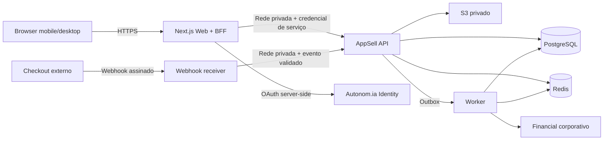

# ADR 0001 — Stack e runtime

- Status: Proposed
- Data: 2026-07-10
- Decisores: Rodrigo / Arquitetura / Segurança / Operações
- Issue: [autonom-ia/appsell#9](https://github.com/autonom-ia/appsell/issues/9)

## Contexto

O produto precisa servir duas jornadas mobile-first distintas — seller e buyer —,
manter isolamento multi-tenant, processar integrações assíncronas e preservar uma
fronteira segura com serviços corporativos existentes. A equipe já opera
TypeScript/React, Python/FastAPI, PostgreSQL, Redis e containers, mas os spikes de
integração ainda não foram executados.

## Decisão proposta

Adotar um modular monolith com fronteiras internas explícitas:

| Camada | Escolha |
|---|---|
| Monorepo | `pnpm` com lockfile congelado e Turborepo |
| Web/BFF | Next.js 16, React 19 estável, TypeScript strict |
| UI | Tailwind CSS 4 e componentes próprios inspirados nos tokens do Studio |
| API de domínio | FastAPI, Python 3.12 e SQLAlchemy 2 async |
| Persistência | PostgreSQL 16 ou superior |
| Jobs/cache | Redis 7 e worker dedicado; outbox no PostgreSQL é a origem durável |
| Assets | storage S3 compatível privado, versionado, com URLs assinadas |
| Contratos | OpenAPI versionada e eventos com `schema_version` explícita |
| Entrega | containers non-root, imutáveis por digest, mesmo artefato em staging/prod |

O monólito é modular por domínio, não uma aplicação sem fronteiras. Módulos
iniciais: identity/session, organizations/memberships, catalog, learning,
commerce-ingestion, entitlements, publication, audit e operations.

## Topologia

Somente Web/BFF e endpoints de webhook explicitamente designados são públicos.
API, PostgreSQL, Redis e worker ficam em rede privada. O storage não concede
listagem pública.

## Restrições de implementação

- UI começa em 360 px; touch target mínimo 44 × 44 px e texto-base 16 px.
- Nenhum fluxo crítico depende só de hover, drag ou swipe.
- Pacotes internos não usam `latest`; versões e integridade ficam fixadas.
- Browser não acessa API de domínio ou serviços internos diretamente.
- O BFF não contém regras de negócio que precisem ser compartilhadas por worker.
- Redis não é fonte de verdade para grants, entitlement, compra ou publicação.
- Upload não transita pela memória do Web/BFF além do necessário para autorizar;
  o fluxo preferido é grant curto para upload seguido de confirmação server-side.
- Staging e produção usam bancos, Redis, buckets, OAuth clients, redes e secrets
  separados.

## Alternativas consideradas

### Backend único em TypeScript

Reduz linguagens e pode simplificar contratos internos. Não foi escolhido como
baseline por ainda não haver evidência de que supera o padrão FastAPI já operado.
Permanece reversível até o spike de scaffold/build.

### Supabase-centric

Oferece Auth/DB/Storage integrados, mas duplicaria a autoridade do Identity e
exigiria desenho adicional de sessão e claims. Pode ser reconsiderado se houver
decisão explícita de substituir, não apenas complementar, componentes.

### Microservices desde o início

Rejeitado para o MVP: amplia deploy, contratos, observabilidade e consistência
distribuída antes de haver carga ou equipes que justifiquem a separação.

### Reusar o UI do Studio como dependência

Rejeitado: a verificação não encontrou pacote UI completo e estável. O Studio é
referência de linguagem visual; componentes do AppSell serão próprios.

## Consequências

Positivas:

- deploy inicial coeso e transações locais para invariantes críticas;
- BFF same-origin reduz exposição de tokens e serviços internos;
- PostgreSQL sustenta constraints, RLS, outbox e auditoria;
- módulos podem ser extraídos no futuro por evidência de carga/ownership.

Custos/riscos:

- duas linguagens exigem disciplina de contrato e toolchains no CI;
- Next.js 16/React 19 precisam ser confirmados contra versões estáveis e licenças
  no momento do scaffold;
- Redis/worker adicionam operação, mesmo sem serem fonte de verdade;
- S3 compatível e CDN ainda precisam de fornecedor e região aprovados.

## Validação obrigatória

1. `pnpm install --frozen-lockfile` e instalação Python limpa.
2. Lint, typecheck, testes e builds sem warnings suprimidos.
3. Containers non-root com health/readiness reais.
4. Teste de integração com PostgreSQL/Redis efêmeros.
5. SBOM e auditoria de licenças sobre os lockfiles reais.
6. Teste responsivo nas larguras 360, 380, 390, 768 e 1024.
7. Medição do bundle e Core Web Vitals em dispositivo móvel suportado.

## Rollback da decisão

Até a primeira migration persistida, a API pode migrar para TypeScript ou outra
alternativa por novo ADR. Depois disso, mudanças de stack exigem plano de
compatibilidade de schema/API, migração por etapas e rollback exercitado.
